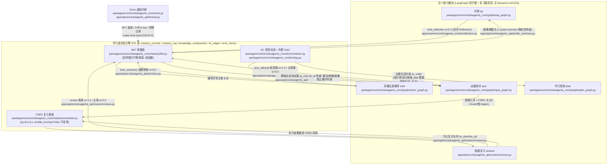

# VLSE 一图流 — 可验证学习者状态引擎 (Verifiable Learner State Engine)

> 本文是 §2 要求的核心创新叙事图: **五个能力模块读写同一个学习者状态引擎**。
> 每条边都标注真实代码文件路径 (答辩现场可当场打开); 数字与状态以
> [STATUS.md](../STATUS.md) 为唯一事实源, 未完成的边如实标注, 不夸大。

## 一句话

ChatGPT 优化的是这一轮对话, EduAgents 优化的是这一个学生: 问答暴露薄弱点 →
测评更新 BKT → FSRS 排复习 → 计划注入复习项 → 学情页可视化 —— 每一环写库、
留审计日志、可复现验证。

## 一图流



## 三组件

| 组件 | 实现 | 关键约束 (真实代码) |
|---|---|---|
| BKT 掌握度 | `packages/core/src/eduagents_core/mastery/bkt.py` | 四参数 P(L0)/P(T)/slip/guess 贝叶斯更新, 纯函数; `weight<1` 时向原 p_mastery 线性插值 (`bkt.py` 权重语义注释), 单测 `tests/unit/test_bkt.py` |
| FSRS 复习调度 | `packages/core/src/eduagents_core/mastery/scheduler.py` | py-fsrs 6.3.1, `enable_fuzzing=False` 保证间隔确定可复现 (演示与 CI 断言依赖); 时间参数显式传入, 函数内禁 `datetime.now()` |
| KC 词表 + 先修 DAG | `packages/core/src/eduagents_core/kc/{normalizer,dag,extraction}.py` | 两遍式归一化 (别名命中→embedding≥0.92 合并→新建), "泰勒公式/Taylor公式/泰勒展开"收敛同一 kc_id (`tests/unit/test_kc.py`, STATUS KC-A1 ✅); DAG 环检测 + 稳定拓扑序 (KC-A3 ✅) |

## 证据类型与权重 (mastery_log 全量落库, 逐条可核对)

| evidence_type | 来源 | 权重 | 写入点 (真实文件) |
|---|---|---|---|
| quiz_attempt | 测评作答 | 客观 1.0 / 主观(LLM 评分≥0.6 记对) 0.5 | `apps/api/src/eduagents_api/services.py` |
| review | 今日复习作答 | 客观 1.0 / 主观 0.5 | `apps/api/src/eduagents_api/routers/reviews.py` |
| tutor_summary | 辅导小结暴露的误解 | 0.5 (按 incorrect) | `apps/api/src/eduagents_api/services.py` |
| chat_reflection | 对话洞察 (后台异步) | 0.3 (`CHAT_EVIDENCE_WEIGHT`, 必须低于测评/辅导) | `apps/worker/src/eduagents_worker/reflection.py` |
| user_override | 用户纠正 ("这个我已经会了") | 1.0 | `apps/api/src/eduagents_api/routers/profile.py` |

写入纪律 (§5.5): 测评/辅导/复习为**确定性直写, 不经 LLM**; 只有对话洞察走后台
Reflection 节点异步抽取——掌握度若由 LLM 生成则不可复现, 也无法作为闭环实验的因变量。

## "可验证"三支柱

1. **引用溯源**: 回答生成阶段即锚定 chunk_id, citation 事件带文档/heading/页码/高亮
   (`packages/core/src/eduagents_core/graphs/qa_graph.py` 生成路径 + `apps/api/src/eduagents_api/routers/chat.py`);
   检索空且 web 空时直接 refused 且该路径不调模型 (STATUS M3-D5 ✅, `tests/integration/test_rag_e2e.py`)。
2. **审计流水**: 每次掌握度变化一行 `mastery_log(old_p, new_p, evidence_type, evidence_id, weight)`,
   逐条 evidence_id 可关联回 attempt (STATUS M4-D4 ✅, `tests/integration/test_reviews_flow.py`);
   用量三维归因 `usage_log(user/feature/model)` (STATUS M1-D4 ✅)。
3. **可复现评测**: 检索评估 CLI + 黄金集版本冻结 (`eval/run_retrieval_eval.py`,
   数字存档 `docs/evidence/m2/ablation_summary.md`); 合成学生闭环实验 10 seeds 配对设计,
   自适应比随机平均少 54.9 题毕业 (p=0.0020, `docs/evidence/m5/report.md`), 快速复现:
   `make demo-m5` (3 seeds, 秒级)。

## 诚实边界 (与 STATUS.md 对齐, 不夸大)

- **规划 ← DAG 拓扑排序的接线**: 拓扑算法与环检测已实现并有 17 个单测
  (`packages/core/src/eduagents_core/kc/dag.py`, KC-A3 ✅), 但 plan 图当前的
  `kc_order` 由调用方注入, 接真实 DAG 的接线标注为 TODO
  (`packages/core/src/eduagents_core/graphs/plan_graph.py` 状态类注释), F3-A2 未勾选。
- **新会话主动引用历史卡点** (F8-A2): 画像注入问答已验
  (`tests/integration/test_vlse_loop.py::test_profile_injected_into_qa`), 开场主动关联待
  Reflection/开场注入收尾 (STATUS M4-D3 🟡)。
- 合成学生实验是**算法层验证** (估计器正确性 + 策略相对优劣), 不宣称等于真人教学效果
  (`docs/evidence/m5/report.md` 方法论说明)。

## 验证命令

```bash
make demo-m3     # 出题 interrupt→resume + VLSE 闭环 (quiz→BKT→FSRS→复习) 集成测试
make demo-m4     # 错题→time-travel→到期复习 + 画像审计一致性
make demo-m5     # 闭环实验快速版 (3 seeds); 正式版报告 docs/evidence/m5/report.md
make time-travel DAYS=3   # 虚拟时钟推进, FSRS 到期与 BKT 衰减可断言 (§9)
```
